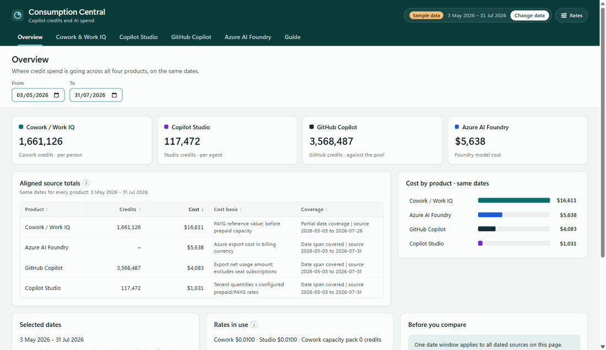

<div align="center">

<br>

# 💳 Consumption Central

### Microsoft Copilot credit consumption and cost, as an app or a Power BI report.

**What you're consuming · what it costs · where to trim · what next year looks like**

<br>

All reports and guides can be found on the [Analytics Hub](https://microsoft.github.io/Analytics-Hub/).

**Also see [Analytics Hub for Microsoft Copilot](https://github.com/microsoft/AnalyticsHub-Dashboard):**
one installer sets up an app on Microsoft Fabric or Azure that shows Copilot and agent adoption,
value, consumption and governance in one place. It includes Consumption Central as its optional
*Credit consumption* add-on.

<br>

**Found this useful? ⭐ Star this repo to help others discover it!**

<br>

**[Videos ↓](#videos)** &nbsp;·&nbsp; **[Before you start ↓](#before-you-start)** &nbsp;·&nbsp; **[Choose your path ↓](#choose-your-path)** &nbsp;·&nbsp; **[Installer ↓](#installer)** &nbsp;·&nbsp; **[Manual ↓](#manual)** &nbsp;·&nbsp; **[After setup ↓](#after-setup)**

<br>

<table>
<tr>
<th width="50%">The app</th>
<th width="50%">The Power BI report</th>
</tr>
<tr>
<td></td>
<td></td>
</tr>
</table>

</div>

## Videos

**Demo: what the report covers, page by page** *(1m 51s)*

https://github.com/user-attachments/assets/702d94f7-74fc-43ad-a259-d00695f76a9c

**Setup guide: getting your own data in, every source, start to finish** *(10m 49s)*

https://github.com/user-attachments/assets/480af64f-53ab-4f4c-b5d2-6f35546fdcfb

Both play here in the page. Where a video differs from the written steps, follow the steps.

**Try the app now, with no setup.** Open
[`app/download/Consumption-Central-App.html`](app/download/Consumption-Central-App.html), choose
**Download raw file**, and open it in Edge or Chrome. It runs offline on sample data.

## What you get

- **The app.** Credit consumption, cost, savings and forecast in six simple tabs.
- **A Power BI report** with the same numbers, if you prefer Power BI.
- **Four products:** Cowork / Work IQ, Copilot Studio, GitHub Copilot and Azure AI Foundry.
  One is enough. The rest stay empty.

## Before you start

- [ ] **Data for at least one product.** [What each one needs →](docs/DATA-SOURCES.md)
- [ ] **Two settings an admin turns on once**, so you can deploy the app.
  [Which ones →](app/README.md#admin-settings)
- [ ] **Power Apps Premium or Copilot Credits** for each person who opens the app.
  [Details →](app/README.md#licensing)
- [ ] **Power BI Pro** to publish the report, and Power BI Desktop to open it.
- [ ] **For the installer:** a Fabric capacity (F2 or larger, or a trial), or a Windows PC with
  PowerShell 7.2 or later. [Full list →](installer/README.md#before-you-start)
- [ ] **Tools:** [Node.js](https://nodejs.org) 24.11 or later and
  [Git](https://git-scm.com/downloads).

## Choose your path

| Path | Best for |
|---|---|
| **[Installer](#installer)** *(recommended, fastest)* | Most people. It sets everything up, loads your data and refreshes it every day. |
| **[Manual](#manual)** *(step by step)* | Trying it on your own files today, choosing each piece yourself, or when you can't run the installer. |

## Installer

It runs in your browser and asks a few questions. It has two routes:

- **Fabric:** loads your data into a Fabric workspace every day, for the report.
- **No Fabric: SharePoint + PAX:** the report reads a SharePoint folder of your exports, and the
  installer also deploys the app.

Steps:

1. Open Command Prompt or PowerShell, and get the code:
   ```
   git clone https://github.com/microsoft/ConsumptionCentral-for-Microsoft-Copilot.git
   cd ConsumptionCentral-for-Microsoft-Copilot/installer
   ```
2. Start the installer. It opens in your browser.
   ```
   npm install
   npx consumption-central-installer --ui
   ```
3. Choose **Set up Consumption Central** and sign in.
4. Choose a route: **Fabric** or **No Fabric: SharePoint + PAX**.
5. Answer the questions. The defaults suit most organisations.
6. Check the plan and approve it. Nothing is created until you do.
7. Wait for it to finish. Follow the cards on the **Done** page, then
   [check it worked](docs/INSTALL.md#check-it-worked).

Every question explained, other ways to start it, and the extra build steps for deploying the app
from a clone: [docs/INSTALL.md](docs/INSTALL.md).

<a id="the-app"></a><a id="app-edition"></a><a id="start-here-the-app-preview"></a><a id="deploy"></a>

## Manual

Start with the app. Add the Power BI report if you want it too.

1. **Deploy the app.** Seven commands, about 10 minutes. [Steps →](app/README.md#commands)
2. <a id="where-your-data-comes-from"></a>**Get your exports.** Each product's click-path and
   permissions are in [docs/DATA-SOURCES.md](docs/DATA-SOURCES.md). File names don't matter.
3. **Load them.** Open [managedapps.cloud.microsoft](https://managedapps.cloud.microsoft), choose
   **Consumption Central**, then **Change data**, and drop in your exports.
4. <a id="the-power-bi-report"></a>**Optional: the Power BI report.** Pick one path and follow
   its folder:

   | Path | Best when | Time |
   |---|---|---|
   | **[1. Local CSV](1.%20Local%20CSV/)** | You want to see it today | ~10 minutes |
   | **[2. Fabric](2.%20Fabric/)** | You want it to refresh on its own | An afternoon |
   | **[3. Viva Direct](3.%20Viva%20Direct/)** | You want Cowork data with no files | ~10 minutes |

   Not sure? Start with Local CSV. Each path ends the same way: open the `.pbit`, fill in one or
   two parameters, choose **Load**. A credit is priced at the $0.01 list price unless you change
   it. To try it first, point it at the synthetic
   [sample data](1.%20Local%20CSV/sample-data/).
5. <a id="viva-identification"></a><a id="turn-on-viva-identification-only-if-you-want-per-person-or-department-views"></a>**Optional: per-person and department views.** An admin
   turns on Viva identification, in about two minutes.
   [Steps →](docs/DATA-SOURCES.md#identified-vs-de-identified)

## After setup

**Check it worked**

- **Installer:** follow [Check it worked](docs/INSTALL.md#check-it-worked).
- **The app:** in **Change data**, each source you loaded is listed and its tab fills in.
- **The report:** your products' pages fill in. A number looks odd?
  [How to read the dashboard](docs/INTERPRETING.md).

**Keep it up to date**

- **Installer:** it refreshes every day. Start it again to check status, update or repair.
- **The app:** drop in new exports any time. To update the app itself, run `git pull`, `npm ci`
  and `npx ms app deploy` in the `app` folder.
- **The report:** schedule its refresh in the Power BI service.
  [Advanced setup →](docs/ADVANCED-SETUP.md)

<a id="support"></a>

**Get help**

- This isn't supported through Microsoft support channels. [Open an issue](../../issues) instead.
- Troubleshooting is in the sections below.

---

<a id="usage-and-compliance"></a>

<details>
<summary><strong>Usage &amp; compliance disclaimer</strong></summary>

This template helps you understand your own Copilot consumption and cost. Microsoft has no
visibility into the data you load, nor control over how the template is used. You are responsible
for ensuring your use complies with applicable law, including data privacy and employment law.
Microsoft disclaims all liability arising from use of this template.

Several underlying exports are **in preview**, and the identifiable variant of the Viva Insights
export processes personal data. Review the "Previews" section of the Microsoft Products and Services
Data Protection Addendum before enabling it, and consult your works council or privacy office where
per-person reporting requires it.

</details>

<details>
<summary><strong>Troubleshooting</strong></summary>

| Problem | Where to look |
|---|---|
| The app won't create, deploy, share or open | [App troubleshooting](app/README.md#troubleshooting) |
| An installer step or load failed | [Check it worked](docs/INSTALL.md#check-it-worked) and [load status and reruns](installer/README.md#load-status-and-reruns) |
| The Viva Direct report won't refresh | [If the refresh fails](3.%20Viva%20Direct/README.md#if-the-refresh-fails) |
| Departments are blank or "Unknown" | [Department breakdowns](docs/ORG-DATA.md) |
| A number looks wrong | [How to read the dashboard](docs/INTERPRETING.md) |

</details>

<a id="documentation"></a>

<details>
<summary><strong>Reference</strong></summary>

| | |
|---|---|
| [How to read the dashboard](docs/INTERPRETING.md) | What every page and figure means |
| [Where the data comes from](docs/DATA-SOURCES.md) | Click-paths and permissions for every export |
| [Running the Viva Insights query](docs/VIVA-QUERY.md) | Building, running and refreshing the query paths 2 and 3 connect to |
| [Department breakdowns](docs/ORG-DATA.md) | How org attributes get in |
| [Rates and pricing](docs/COMMERCIAL-TERMS.md) | What to set and where to find it |
| [Every measure explained](docs/MEASURES.md) | Reference |
| [Advanced setup](docs/ADVANCED-SETUP.md) | Scheduling, service principals, gateway refresh |
| [Install](docs/INSTALL.md) and [the installer](installer/README.md) | Every question, route and command |
| [The app](app/README.md) | Deploy, admin settings, licensing, tabs, data detection and development |
| [Fabric App](fabric-app/README.md) | The app on your published Fabric model: deploy, share, settings |

<a id="fabric-app"></a><a id="the-fabric-app-alternative"></a>

**The Fabric App** *(alternative)*. On Microsoft Fabric already, with the [2. Fabric](2.%20Fabric/)
path's model published? [`fabric-app/`](fabric-app/) deploys Consumption Central into your Fabric
workspace as a web app. It reads your published semantic model live, as the person viewing it, so
row-level security applies, and it keeps no copy of your data. From `fabric-app/` (Node.js 22.22+
or 24.15+):

```powershell
npm install
npm run deploy:cc -- --workspace-uri "https://app.fabric.microsoft.com/groups/<workspace-id>/list"
```

Add `--dry-run` first to see which model it found without deploying. It needs a workspace on Fabric
capacity and the **Fabric Apps (preview)** and **Semantic Model Execute Queries REST API** tenant
settings. Have [ValueLens](https://github.com/microsoft/ValueLens-for-Microsoft-Copilot) too? The
same folder deploys a joined app (`npm run deploy:both`) or ValueLens alone (`npm run deploy:vl`).
[Fabric App details →](fabric-app/README.md)

No published model? Host the CSV app in a Fabric workspace instead
([steps](app/README.md#as-a-fabric-app-in-a-fabric-workspace)).

**Testing.** Built and tested end to end against live tenant data on all three report paths. The
sample dataset is synthetic. If you schedule the Azure collectors, complete the
[Azure acceptance procedure](docs/TESTING.md#azure-automation-acceptance) in your own environment.

</details>

<a id="archived"></a>

<details>
<summary><strong>Archived options</strong></summary>

- **[Power Automate + Dataverse](archive/4.%20Power%20Automate%20%2B%20Dataverse/README.md)**, which
  was path 4. Flows you already run keep working, but the route is unsupported and gets no fixes.
- **[Previous template versions](archive/README.md)**.

</details>

---

## Contributing

Issues and pull requests welcome. See [CONTRIBUTING.md](CONTRIBUTING.md).

## Trademarks

This project may contain trademarks or logos for projects, products, or services. Authorized use of
Microsoft trademarks or logos is subject to and must follow
[Microsoft's Trademark & Brand Guidelines](https://www.microsoft.com/legal/intellectualproperty/trademarks/usage/general).
Use of third-party trademarks or logos is subject to those third-parties' policies.
