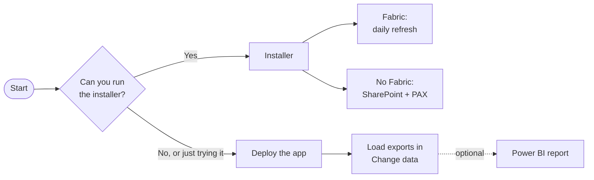

<div align="center">

<br>

# 💳 Consumption Central

### Microsoft Copilot credit consumption and cost, as an app or a Power BI report.

**What you're consuming · what it costs · where to trim · what next year looks like**

<br>

All reports and guides can be found on the [Analytics Hub](https://microsoft.github.io/Analytics-Hub/).

**Also see [Analytics Hub for Microsoft Copilot](https://github.com/microsoft/AnalyticsHub-Dashboard):**
one installer sets up an app on Microsoft Fabric or Azure that shows Copilot and agent adoption,
value, consumption and governance in one place. It includes Consumption Central as its optional
*Credit consumption* add-on.

<br>

**Found this useful? ⭐ Star this repo to help others discover it!**

<br>

**[Videos ↓](#videos)** &nbsp;·&nbsp; **[Before you start ↓](#before-you-start)** &nbsp;·&nbsp; **[Choose your path ↓](#choose-your-path)** &nbsp;·&nbsp; **[Installer ↓](#installer)** &nbsp;·&nbsp; **[Manual ↓](#manual)** &nbsp;·&nbsp; **[After setup ↓](#after-setup)**

<br>

<table>
<tr>
<th width="50%">The app</th>
<th width="50%">The Power BI report</th>
</tr>
<tr>
<td></td>
<td></td>
</tr>
</table>

</div>

## Videos

**Demo: what the report covers, page by page** *(1m 51s)*

[](https://youtu.be/JdOVx_6kw5Y)

**▶ [Watch overview on YouTube](https://youtu.be/JdOVx_6kw5Y)**

**Setup guide: getting your own data in, every source, start to finish** *(10m 49s)*

[](https://youtu.be/0fgvP8mutTo)

**▶ [Watch setup guide on YouTube](https://youtu.be/0fgvP8mutTo)**

Where a video differs from the written steps, follow the steps.

**Try the app now, with no setup.** Open
[`app/download/Consumption-Central-App.html`](app/download/Consumption-Central-App.html), choose
**Download raw file**, and open it in Edge or Chrome. It runs offline on sample data.

## What you get

- **The app:** credit consumption, cost, savings and forecast in six tabs.
- **A Power BI report** with the same numbers, if you prefer Power BI.
- **Four products:** Cowork / Work IQ, Copilot Studio, GitHub Copilot and Azure AI Foundry.
  One is enough.

## Before you start

- [ ] Data for at least one product. [What each needs →](docs/DATA-SOURCES.md)
- [ ] Two admin settings, turned on once. [Which →](app/README.md#admin-settings)
- [ ] Power Apps Premium or Copilot Credits for each app user. [Details →](app/README.md#licensing)
- [ ] Power BI Pro and Power BI Desktop, for the report.
- [ ] [Node.js](https://nodejs.org) 24.11+ and [Git](https://git-scm.com/downloads).
- [ ] For the installer: Fabric F2+ (or a trial), or Windows with PowerShell 7.2+.
  [Full list →](installer/README.md#before-you-start)

## Choose your path



| Path | Best for |
|---|---|
| **[Installer](#installer)** *(recommended)* | Most people. It sets everything up and refreshes daily. |
| **[Manual](#manual)** | Trying your own files today, or when you can't run the installer. |

## Installer

1. Get the code:
   ```
   git clone https://github.com/microsoft/ConsumptionCentral-for-Microsoft-Copilot.git
   cd ConsumptionCentral-for-Microsoft-Copilot/installer
   ```
2. Start it. It opens in your browser:
   ```
   npm install
   npx consumption-central-installer --ui
   ```
3. Choose **Set up Consumption Central** and sign in.
4. Pick a route. **Fabric** loads your data into a workspace daily. **No Fabric: SharePoint + PAX**
   reads a SharePoint folder and also deploys the app.
5. Answer the questions. The defaults suit most organisations.
6. Approve the plan. Nothing is created before you do.
7. Follow the cards on the **Done** page, then [check it worked](docs/INSTALL.md#check-it-worked).

Every question and other ways to start it: [docs/INSTALL.md](docs/INSTALL.md). On the No Fabric
route, build the app first so the installer can deploy it from a clone:
[Without the exe](docs/INSTALL.md#without-the-exe).

<a id="the-app"></a><a id="app-edition"></a><a id="start-here-the-app-preview"></a><a id="deploy"></a>

## Manual

1. **Deploy the app.** About 10 minutes. [Steps →](app/README.md#commands)
2. <a id="where-your-data-comes-from"></a>**Get your exports.**
   [Where each one is →](docs/DATA-SOURCES.md)
3. **Load them.** Open [managedapps.cloud.microsoft](https://managedapps.cloud.microsoft), choose
   **Consumption Central**, then **Change data**.
4. <a id="the-power-bi-report"></a>**Optional: the Power BI report.** Pick one folder:

   | Path | Best when | Time |
   |---|---|---|
   | **[1. Local CSV](1.%20Local%20CSV/)** | You want it today | ~10 min |
   | **[2. Fabric](2.%20Fabric/)** | You want it to refresh itself | An afternoon |
   | **[3. Viva Direct](3.%20Viva%20Direct/)** | You want Cowork data with no files | ~10 min |

   Not sure? Start with Local CSV. Try it on the [sample data](1.%20Local%20CSV/sample-data/).
5. <a id="viva-identification"></a><a id="turn-on-viva-identification-only-if-you-want-per-person-or-department-views"></a>**Optional: per-person and department views.**
   An admin turns on Viva identification. [Steps →](docs/DATA-SOURCES.md#identified-vs-de-identified)

**Already using a Power BI template (Local CSV or Viva Direct)?** Deploy the app (step 1), then
load the same exports in **Change data**. Your report keeps working. On Viva Direct, download the
Cowork export from Viva Insights first ([where](docs/DATA-SOURCES.md#where)).

<a id="support"></a>

## After setup

| | Check it worked | Keep it up to date |
|---|---|---|
| **Installer** | [Check it worked](docs/INSTALL.md#check-it-worked) | Refreshes daily. Start it again to update or repair. |
| **The app** | Each loaded source is listed in **Change data** | Drop in new exports any time. [Update the app →](app/README.md#update) |
| **The report** | Your products' pages fill in | Schedule a refresh in the Power BI service. [How →](docs/ADVANCED-SETUP.md) |

A number looks odd? [How to read the dashboard](docs/INTERPRETING.md).
Need help? This isn't covered by Microsoft support. [Open an issue](../../issues).

---

<a id="usage-and-compliance"></a>

<details>
<summary><strong>Usage &amp; compliance disclaimer</strong></summary>

This template helps you understand your own Copilot consumption and cost. Microsoft has no
visibility into the data you load, nor control over how the template is used. You are responsible
for ensuring your use complies with applicable law, including data privacy and employment law.
Microsoft disclaims all liability arising from use of this template.

Several underlying exports are **in preview**, and the identifiable variant of the Viva Insights
export processes personal data. Review the "Previews" section of the Microsoft Products and Services
Data Protection Addendum before enabling it, and consult your works council or privacy office where
per-person reporting requires it.

</details>

<details>
<summary><strong>Troubleshooting</strong></summary>

| Problem | Where to look |
|---|---|
| The app won't create, deploy, share or open | [App troubleshooting](app/README.md#troubleshooting) |
| An installer step or load failed | [Check it worked](docs/INSTALL.md#check-it-worked) and [load status and reruns](installer/README.md#load-status-and-reruns) |
| The Viva Direct report won't refresh | [If the refresh fails](3.%20Viva%20Direct/README.md#if-the-refresh-fails) |
| Departments are blank or "Unknown" | [Department breakdowns](docs/ORG-DATA.md) |
| A number looks wrong | [How to read the dashboard](docs/INTERPRETING.md) |

</details>

<a id="documentation"></a>

<details>
<summary><strong>Reference</strong></summary>

| | |
|---|---|
| [How to read the dashboard](docs/INTERPRETING.md) | What every page and figure means |
| [Where the data comes from](docs/DATA-SOURCES.md) | Click-paths and permissions for every export |
| [Running the Viva Insights query](docs/VIVA-QUERY.md) | The query paths 2 and 3 connect to |
| [Department breakdowns](docs/ORG-DATA.md) | How org attributes get in |
| [Rates and pricing](docs/COMMERCIAL-TERMS.md) | What to set and where to find it. Credits default to the $0.01 list price. |
| [Every measure explained](docs/MEASURES.md) | Reference |
| [Advanced setup](docs/ADVANCED-SETUP.md) | Scheduling, service principals, gateway refresh |
| [Install](docs/INSTALL.md) and [the installer](installer/README.md) | Every question, route and command |
| [The app](app/README.md) | Deploy, admin settings, licensing, tabs and development |
| [Fabric App](fabric-app/README.md) | The app on your published Fabric model |

<a id="fabric-app"></a><a id="the-fabric-app-alternative"></a>

**The Fabric App** *(alternative).* Already on the [2. Fabric](2.%20Fabric/) path?
[`fabric-app/`](fabric-app/) deploys Consumption Central into your Fabric workspace as a web app.
It reads your published model live, as the viewer, so row-level security applies, and it keeps no
copy of your data. It can also deploy ValueLens alongside.
[Prerequisites and commands →](fabric-app/README.md)
No published model? [Host the CSV app in Fabric instead](app/README.md#as-a-fabric-app-in-a-fabric-workspace).

**Testing.** Built and tested end to end against live tenant data on all three report paths. The
sample data is synthetic. If you schedule the Azure collectors, complete the
[Azure acceptance procedure](docs/TESTING.md#azure-automation-acceptance) in your own environment.

</details>

<a id="archived"></a>

<details>
<summary><strong>Archived options</strong></summary>

- **[Power Automate + Dataverse](archive/4.%20Power%20Automate%20%2B%20Dataverse/README.md)**, which
  was path 4. Flows you already run keep working, but the route is unsupported and gets no fixes.
- **[Previous template versions](archive/README.md)**.

</details>

---

## Contributing

Issues and pull requests welcome. See [CONTRIBUTING.md](CONTRIBUTING.md).

## Trademarks

This project may contain trademarks or logos for projects, products, or services. Authorized use of
Microsoft trademarks or logos is subject to and must follow
[Microsoft's Trademark & Brand Guidelines](https://www.microsoft.com/legal/intellectualproperty/trademarks/usage/general).
Use of third-party trademarks or logos is subject to those third-parties' policies.
